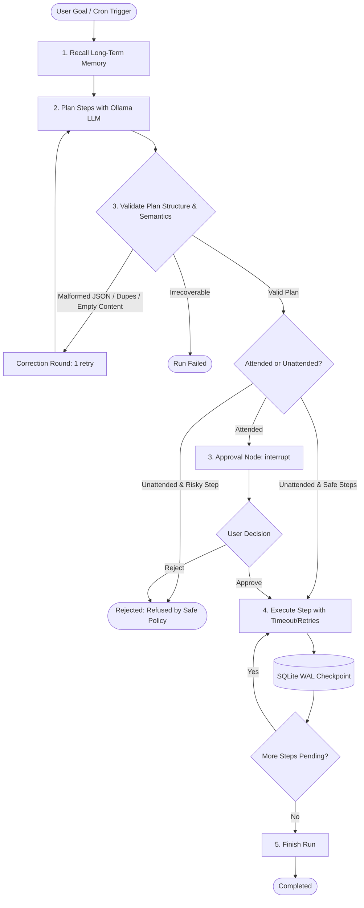

# Architecture & Internal Mechanics

This document details the internal design of the **Always-On Planning Agent**, including the LangGraph state machine, checkpointing model, crash recovery mechanics, and process concurrency boundaries.

---

## State Machine Lifecycle

The agent workflow is implemented as a compiled [LangGraph](https://github.com/langchain-ai/langgraph) state machine in [agent/graph.py](file:///b:/My%20Project/always-on-agent/agent/graph.py).

---

## The 5 Nodes Explained

### 1. `recall`
- Reads persistent user memories from SQLite via [LongTermMemory](file:///b:/My%20Project/always-on-agent/agent/memory.py) filtered by `user_id`.
- Initializes a fresh runtime state for the thread (`completed = []`, `results = []`, `plan_decision = None`).

### 2. `plan`
- Formulates a system prompt containing user memories, goal, available tool definitions from `describe_tools()`, and strict JSON schema rules.
- Invokes Ollama with `temperature=0`.
- **Validation**:
  - Validates JSON output structure.
  - Verifies that arguments strictly match registered parameter schemas in [agent/tools.py](file:///b:/My%20Project/always-on-agent/agent/tools.py).
  - Checks semantic constraints: ensures `create_note` content is not empty, and rejects plans attempting to write to the same file twice.
  - If invalid, the planner receives **one correction round** containing the specific error message.

### 3. `approval`
- **Whole-Plan Gate**: Interrupts the entire plan upfront before any step executes.
- **Attended Runs**: Calls LangGraph's `interrupt()`, which freezes graph execution and emits the full plan to the caller.
- **Unattended Runs (Cron)**: Inspects the plan for any tool flagged `requires_approval=True` (e.g. `delete_note`). If found, it refuses execution with `plan_decision = "rejected"` to avoid hanging headless background jobs.

### 4. `execute`
- Executes one pending step per node visit.
- Uses a `ThreadPoolExecutor` bounded by `AGENT_TOOL_TIMEOUT` (default: 20s) with exponential retry backoff.
- Logs step execution output into `results`.
- Commits state to SQLite via `SqliteSaver` after every single step.

### 5. `finish`
- Evaluates final state. If the plan was rejected, sets `status = "rejected"`.
- If any tool failed non-critically or was skipped, sets `status = "completed_with_skips"`, otherwise `status = "completed"`.

---

## Crash Recovery & Checkpointing

Traditional agents store state in process memory. If the machine reboots, crashes, or loses power, the agent loses context and must re-plan and repeat steps from scratch.

### SQLite WAL Mode
The database connection in [agent/db.py](file:///b:/My%20Project/always-on-agent/agent/db.py) uses Write-Ahead Logging (`PRAGMA journal_mode=WAL`), providing:
1. **Atomic commits**: Crashes mid-step never corrupt state.
2. **Concurrent read access**: The CLI can inspect running tasks, read schedules, or query memory while the scheduler daemon runs.

### Resuming Without Repeating Work
When a paused run is resumed or an interrupted run recovers:
1. The graph inspects `completed` step IDs in the checkpoint state.
2. It fetches the next step from `plan` whose ID is not in `completed`.
3. It resumes execution at that exact step. **Resuming never calls the planner again.**

---

## Process Concurrency & Thread Safety

In [agent/service.py](file:///b:/My%20Project/always-on-agent/agent/service.py), `AgentService` maintains a re-entrant lock (`threading.RLock`) around all graph invocations:
- Prevents scheduled cron jobs and CLI calls running inside the same process from interleaving writes across the SQLite connection.
- Keeps checkpoints strictly isolated per `thread_id`.
